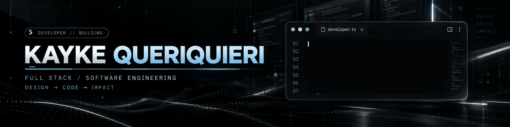

<!-- KAYKE SILVA • PERFIL GITHUB -->
<!-- IMPORTANTE: mantenha assets/kayke-banner.png neste mesmo repositório. -->

<div align="center">



<br />

<a href="https://github.com/KaykeQQ">
  
</a>

<br />


</div>

---

## `> whoami`

Sou **Kayke Queriquieri**, estudante de **Engenharia de Software** e desenvolvedor em formação, com foco em criar produtos digitais que unam **design, experiência do usuário e código bem estruturado**.

Tenho formação técnica em Informática e desenvolvo projetos envolvendo **interfaces web, back-end, bancos de dados e automação de processos**.

```typescript
const kayke = {
  area: "Desenvolvimento Full Stack",
  estudando: "Engenharia de Software",
  interesses: ["Web", "UI/UX", "APIs", "Automações", "IA"],
  objetivo: "Criar software útil, bonito e escalável",
};
```

## `tech_stack --show-all`

<div align="center">

### Linguagens e fundamentos

<p>
  
</p>

### Infraestrutura e ambiente

<p>
  
  
  
</p>

### Automação e ferramentas

<p>
  
</p>

</div>

---

## `> ls ./projects --featured`

<table>
  <tr>
    <td width="50%" valign="top">
      <h3 align="center">🏋️ Impacto Life Fitness</h3>
      <p align="center">Site para academia, com interface responsiva, identidade visual moderna e foco em apresentar serviços e gerar contatos.</p>
      <p align="center">  </p>
      <p align="center"><a href="https://github.com/KaykeQQ/SiteImpactoLifeFitness"></a></p>
    </td>
    <td width="50%" valign="top">
      <h3 align="center">🐾 PetShop</h3>
      <p align="center">Projeto de back-end desenvolvido com Node.js, Express e TypeScript, com organização de código para serviços web.</p>
      <p align="center">  </p>
      <p align="center"><a href="https://github.com/KaykeQQ/PetShop"></a></p>
    </td>
  </tr>
</table>

## `> github --analytics`

<div align="center">
  
  
</div>

<br />

<div align="center">
  
</div>

---

## `> roadmap --current`

- **Front-end:** interfaces responsivas, componentização, performance e acessibilidade.
- **Back-end:** APIs, modelagem de dados e integrações.
- **Automação:** fluxos com n8n, scripts Python e ferramentas para produtividade.
- **Engenharia de Software:** arquitetura, organização e evolução contínua dos projetos.

<div align="center">

### `> connect --with-me`

<a href="https://github.com/KaykeQQ"></a>

<br /><br />

<sub>"O melhor jeito de aprender a construir é continuar construindo."</sub>


</div>
